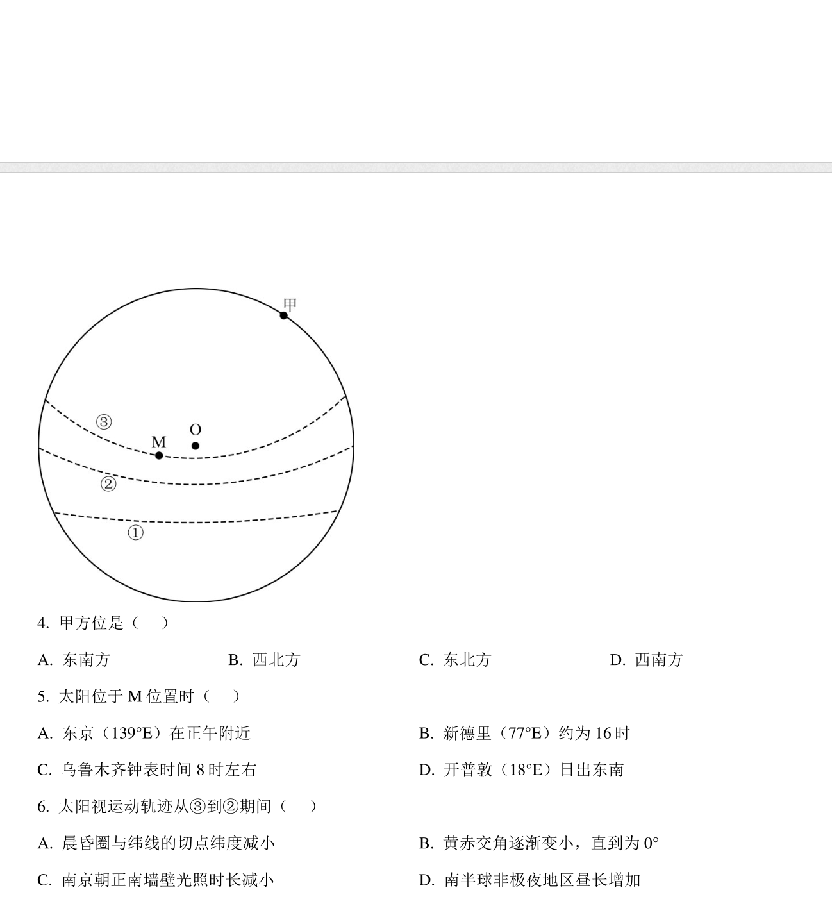

## 想法

起因是一道南京背景的太阳视运动选择题：图为二分二至日太阳视运动轨迹，标出了甲、M、O 三个位置，后面跟了三道小题。答案依次是 B、A、D，不过这不是重点——我真正想用程序验证的是**第三题（第 6 题）的 C 选项**：

> C. 南京朝正南墙壁光照时长减少

如果 C 成立，第三题就不该选 D。于是干脆把南京 2026 年每一天太阳什么时候到正东、什么时候到正西算出来，用数据说话。

## 原题

**来源**：2025 年春学期金坛一中高二年级地理学科 4 月阶段性调研试卷（第 4–6 题）

> 南京（32°N，118°E）某中学学生用广角相机记录天空中的太阳轨迹，下图为二分二至日太阳视运动轨迹示意图，其中外围圆圈为地平圈，圆心 O 为天顶。据此完成下面小题。

**4. 甲方位是（ ）**

A. 东南方　　B. 西北方　　C. 东北方　　D. 西南方

**5. 太阳位于 M 位置时（ ）**

A. 东京（139°E）在正午附近
B. 新德里（77°E）约为 16 时
C. 乌鲁木齐钟表时间 8 时左右
D. 开普敦（18°E）日出东南

**6. 太阳视运动轨迹从 ③ 到 ② 期间（ ）**

A. 晨昏圈与纬线的切点纬度减小
B. 黄赤交角逐渐变小，直到为 0°
C. 南京朝正南墙壁光照时长减少
D. 南半球非极夜地区昼长增加

## 答案

**4 → B（西北方）　5 → A（东京在正午附近）　6 → D（南半球非极夜地区昼长增加）**

即三题答案依次为 **B、A、D**。第 4、5 题不展开，重点看下面的 C 选项验证。

## 重点：程序验证的是第 6 题的 C 选项

C 选项说“南京朝正南墙壁光照时长减少”。朝南的墙被太阳直接照到的时间，对应太阳位于正东到正西之间的时段——正好对应程序里的 `timeA`（太阳正东）到 `timeB`（太阳正西）的时长。

从夏至（③）到秋分（②），程序算出的数据是：

| 日期 | 太阳正东 timeA | 太阳正西 timeB | 朝南墙光照时长 |
| --- | --- | --- | --- |
| 06-21 夏至 | 09:01:48 | 15:11:27 | 06:09:39 |
| 09-23 秋分 | 05:57:42 | 17:58:19 | 12:00:37 |

太阳升到正东的时间逐日提前（09:01 → 05:57），到达正西的时间逐日推迟（15:11 → 17:58），光照时长从 6 小时 09 分**增加**到 12 小时 00 分。

**所以 C 项“光照时长减少”是错的，第 6 题只能选 D。**

顺带补充 D 项为什么对：夏至 → 秋分，太阳直射点从北回归线南移到赤道，南半球非极夜地区昼长逐渐增加，D 成立。

## 计算与项目

- 纯标准库 Python，NOAA Solar Calculator 算法（Meeus / Astronomical Almanac），精度约 0.01°；
- 南京坐标 32°03′39″N、118°46′44″E，UTC+8；
- 逐日计算 06:00 / 18:00 的方位角与高度角，并用二分法解 `azimuth = 90°` / `270°` 得到 timeA / timeB；
- 极值：06-21 时长最短（06:09:39），12-22 最长（17:50:45）。

代码与数据：

- `projects/nanjing-solar-2026/solar.py` — 核心算法（NOAA，纯标准库）
- `projects/nanjing-solar-2026/calculate_2026.py` — 逐日计算，输出 CSV
- `projects/nanjing-solar-2026/output/nanjing_solar_2026.csv` — 2026 年 365 天逐日结果
- 原题图：`ideas/assets/2026-10-20-nanjing-solar-2026-question.png`

## 参考

- NOAA Solar Calculator: <https://gml.noaa.gov/grad/solcalc/>
- Jean Meeus,《Astronomical Algorithms》
